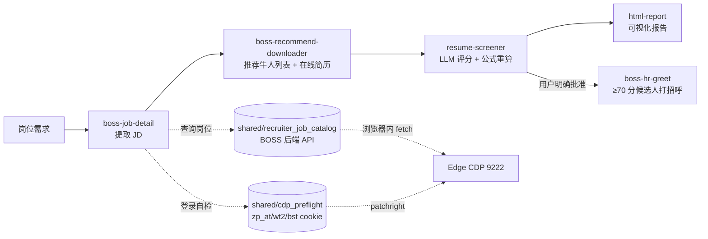

# HR 辅助招聘

> [!NOTE]
> 本项目由 **7 个 Skill** 组成，围绕 BOSS 直聘的岗位信息提取、简历获取、评分和报告生成，提供一套可由智能体执行的招聘辅助流程。浏览器操作通过 patchright 和 CDP 连接专用 Edge；登录、筛选条件确认由用户完成，打招呼须经用户明确批准。
>
> **统一入口**：智能体和用户通过 [`boss-hr` 命令](docs/CLI_WORKFLOW.md)调用工具包。公开命令包括 `doctor`、`start`、`confirm`、`fetch`、`score`、`report`、`greet` 和 `status`；不要直接运行底层脚本。智能体从 [`boss-hr-auto/SKILL.md`](boss-hr-auto/SKILL.md) 开始。
>
> **运行方式**：工具包不依赖第三方 BOSS CLI。BOSS HTTP 请求在已登录的浏览器会话内发起；岗位查询由 `shared/recruiter_job_catalog.py` 负责，登录状态由 `shared/cdp_preflight.py` 检查。
>
> **发布形式**：项目以 GitHub 源码工具包提供，需在仓库目录执行 `pip install -e .`（editable install）。它不是独立 wheel；移动源码目录后，需重新安装才能继续使用 `boss-hr`。

<p align="center">
  
  
  
</p>

---

## 目录

- [快速开始](#快速开始)
- [macOS 安装与执行](docs/MACOS.md)
- [项目能力](#项目能力)
- [Skill 与工作流](#skill-与工作流)
- [评分系统](#评分系统)
- [安全与风控](#安全与风控)
- [项目结构](#项目结构)
- [输出文件](#输出文件)
- [环境变量](#环境变量)
- [相关链接](#相关链接)

---

## 快速开始

**推荐环境**：Python 3.10+；Windows 使用 Edge，macOS 使用 Chrome。macOS 安装和运行步骤见 [macOS 安装与执行](docs/MACOS.md)。完整招聘流程此前仅在 Windows 上验证过。

正常使用无需预先手动启动浏览器或运行 `boss-hr doctor`。安装后直接执行 `boss-hr start`：

1. 若 9222 端口已有已登录的浏览器会话，直接进入业务流程。
2. 若端口未开启，自动启动专用浏览器（Windows Edge / macOS Chrome，调试端口 9222），不使用日常浏览器配置目录。
3. 若尚未登录，打开 BOSS 招聘者登录页，立即返回 `status=waiting_user_login`，不创建 run。
4. 用户在专用浏览器中登录后，重试同一条 `start` 命令即可继续。

`boss-hr doctor` 用于独立诊断环境，不是 `start` 的必经步骤。

```bash
git clone https://github.com/neflibata92-svg/HR-recruiting-assistant.git
cd HR-recruiting-assistant
python -m pip install -e .

# 验证安装：应列出 8 个公开命令（含 doctor）
boss-hr --help
python -m boss_hr --help # 等价入口
```

以下是主要业务流程；`doctor` 用于诊断环境，完整命令说明见 [CLI 工作流](docs/CLI_WORKFLOW.md)。

```bash
# 1. 创建 run，并等待人工确认筛选条件
boss-hr start "<encryptJobId|jobId|岗位名>" \
  --job-name "<岗位名>" --encrypt-job-id "<id>"
# → status=waiting_user_confirmation，run_id=...
# → 智能体停下，等待用户在 BOSS 推荐牛人页面调整筛选条件
# 若返回 waiting_user_login：先在专用 Edge 中登录，再重试同一条 start

# 用户确认筛选条件并回复“继续”后：
# 2. 确认并获取简历
boss-hr confirm --job-name "<>" --encrypt-job-id "<>" --run-id "<rid>"
boss-hr fetch   --job-name "<>" --encrypt-job-id "<>" --run-id "<rid>" --count N

# 3. 评分：每次处理一位候选人，完成后再次调用同一命令
boss-hr score   --job-name "<>" --encrypt-job-id "<>" --run-id "<rid>"
# → 读取返回的 input_file，按 resume-screener/SKILL.md 评 4 个维度
#   （学历 edu 由分档表计算）；写入 output_file 后再次调用 score
boss-hr score   --job-name "<>" --encrypt-job-id "<>" --run-id "<rid>"
# → status=scoring_complete

# 4. report
boss-hr report  --job-name "<>" --encrypt-job-id "<>" --run-id "<rid>"

# 5. 可选：经用户明确批准后执行 greet（会在 BOSS 页面产生真实操作）
boss-hr greet   --job-name "<>" --encrypt-job-id "<>" --run-id "<rid>"

# 6. 任意时点查看当前 run 状态
boss-hr status  --job-name "<>" --encrypt-job-id "<>" --run-id "<rid>"
```

> [!IMPORTANT]
> **当前限制**：
> - 不支持 `continue` / `batch` / 多批累计
> - 真实 `greet` 成功点击（≥70 分候选人实际点击发送）尚未完成受控验证
> - 完整招聘流程此前仅在 Windows 上验证过；macOS / Linux 需自测

### 环境准备与首次登录

工具包不需要单独打包浏览器二进制文件；Python 依赖通过安装命令获取，浏览器使用系统已安装的版本。

| 依赖 | 用途 | 准备方式 |
|------|------|---------|
| Python 3.10+ | 运行工具包 | 从 [python.org](https://python.org) 安装 |
| patchright | 连接 CDP 浏览器；不包含浏览器，也不会下载 Chromium | 运行 `pip install -e .` 时安装 |
| Edge / Chrome | 承载 BOSS 招聘者登录会话 | 使用系统已安装的浏览器；Windows 推荐 Edge |

正常流程由 `boss-hr start` 自动启动专用浏览器，并在需要时打开 BOSS 登录页。请在该窗口**人工扫码登录**。`start` 未登录时立即返回；`fetch` 和 `greet` 可按其等待参数轮询登录。自动启动失败时可运行 `boss-hr doctor --launch-browser` 排查。

只有自动启动失败或需要自行控制浏览器时，才手动开启 CDP：

**Windows（Edge）：**

```powershell
Start-Process "msedge" -ArgumentList `
  "--remote-debugging-port=9222", `
  "--user-data-dir=$env:LOCALAPPDATA\boss-hr-edge-profile"
```

**macOS（Chrome）：**见 [macOS 安装与执行](docs/MACOS.md)。Linux 需按发行版实际浏览器路径自行启动 CDP，尚未完成端到端验证。

登录状态由工具自动检查 `zp_at`、`wt2` 和 `bst` Cookie。排查时可用共享模块自检：

```python
from shared.cdp_preflight import connect_cdp, check_login
session = connect_cdp()        # 默认连接 http://localhost:9222
print(check_login(session))    # {'logged_in': True/False, 'cookies': {...}, ...}
```

在支持 Skill 的智能体中，可以从 `boss-hr-auto` 发起流程，例如 `@skill://boss-hr-auto 机械工程师`；也可以直接提出“帮我筛选机械工程师的简历”。

---

## 项目能力

给出招聘岗位后，工具包按顺序提取 JD、获取候选人简历、评分并生成可视化报告。智能体负责调用统一 CLI；HR 负责登录、确认筛选条件，并决定是否给高分候选人打招呼。

| 能力 | 具体工作 |
|------|----------|
| JD 提取 | 获取岗位详情、任职要求和核心技能点 |
| 简历获取 | 从推荐牛人页面获取候选人简历 |
| 智能评分 | 按 5 个维度加权评分，结合学历分档和硬门槛过滤 |
| 可视化报告 | 生成排名表、五维雷达图和个性化沟通建议 |
| 打招呼 | 经用户明确批准后，给达到推荐阈值的候选人点击 BOSS 打招呼按钮 |
| 测试 | `tests/` 覆盖核心算法的单元测试 |

`boss-hr-auto` 是智能体的统一入口，其余 Skill 承担具体步骤。自 2026-07-29 的目录设计调整起，6 个底层 CLI 脚本接受 `--encrypt-job-id` 或环境变量 `BOSS_HR_ENCRYPT_JOB_ID`；工作区按 BOSS 的 `encryptJobId` 建目录，详见[输出文件](#输出文件)。

---

## Skill 与工作流

| Skill | 角色 | 作用 |
|-------|------|------|
| `boss-hr-auto` | 统一入口 | 按步骤编排工作流，并在人工确认节点停下 |
| `boss-job-detail` | 步骤 1 | 提取岗位 JD |
| `boss-recommend-downloader` | 步骤 2 | 获取推荐牛人列表和简历；底层包含 `run_all` |
| `resume-screener` | 步骤 3 | 硬门槛过滤、加权评分和学历分档 |
| `html-report` | 步骤 4 | 生成 HTML 报告与沟通建议 |
| `boss-hr-greet` | 可选步骤 5 | 经用户明确批准后给高分候选人打招呼 |
| `shared` | 共享能力 | 提供浏览器连接、岗位解析及运行数据管理 |

其中，`shared/cdp_preflight.py` 负责 CDP 连接和登录状态检查；`shared/recruiter_job_catalog.py` 负责查询招聘者岗位并解析 `encryptJobId`。

### 工作流示意图



虚线箭头表示底层依赖：`boss-job-detail` 通过 `recruiter_job_catalog` 查询岗位；各步骤通过 `cdp_preflight` 检查登录状态，并使用 patchright 连接本地 Edge 的 9222 端口，复用该浏览器会话。

---

## 评分系统

### 当前权重（5 维加权求和）

> [!NOTE]
> `resume-screener/scripts/score_resumes.py` 使用一套 5 维权重，合计 100%。如需区分岗位类型，可在 `WEIGHTS` 常量上扩展，避免分散硬编码。

| 维度 | 权重 | 评分方法 |
|------|:----:|---------|
| 学历 (edu) | **25%** | `validate_score()` 用 `school_tier.py` 分档表**强制覆盖** LLM 给的 edu 分；硕士 +8% |
| 工作经验 (exp) | **25%** | 相关经验年限 + 业务匹配度 |
| 专业技能 (skill) | **25%** | JD 技能覆盖率 |
| 项目经历 (proj) | **15%** | 项目复杂度 + 相关性 |
| 专业匹配 (major) | **10%** | 对口=100%，相关=80%，无关=30-60% |

### 总分与档位

- `weighted[d] = round(dims[d] * WEIGHTS[d], 2)`
- `total = round(sum(weighted.values()), 1)`
- 档位阈值：`>= 70` → **推荐**　`>= 60` → **待定**　否则 → **不推荐**
- 全部逻辑在 `resume-screener/scripts/score_resumes.py`，由 `tests/` 下的单元测试用例覆盖：`python -m pytest tests/`

### 学历分档表

| 档次 | 分数 | 示例 |
|------|:----:|------|
| C9 | 100 | 清华、北大、复旦、交大等 |
| 985 | 92 | 其他 985 高校 |
| 211 | 85 | 其他 211 高校 |
| 双一流 | 77 | 双一流建设高校 |
| 一本公办 | 71 | 省属重点一本 |
| 二本公办 | 62 | 普通公办二本 |
| 民办本科 | 53 | 民办高校、独立学院 |

> [!IMPORTANT]
> 学历评分必须严格执行分档表，**禁止给所有人相同分数**。

### 行动建议规则

输出格式：`📊 排名表（含 5 维加权分）+ 📋 每人评分依据 + 🎯 个性化行动建议`

- **推荐面试**：每人必须写「候选人背景」+「沟通方向」
- **待沟通确认**：每人必须写「优势」+「需确认问题」
- ❌ 禁止所有人使用相同的沟通方向

---

## 安全与风控

### 推荐牛人下载

| 做法 | 说明 |
|:----:|------|
| 浏览器会话 | 通过 patchright 连接 Edge，在已登录的浏览器会话中发起请求 |
| 滚动间隔 | 随机等待 3–6 秒，为页面加载留出时间 |
| 简历获取间隔 | 随机等待 60–120 秒，每处理 5 人增加一次较长等待 |
| 建议运行时间 | 9:00–18:00 |
| 单次建议数量 | 不超过 50 人；更多候选人分批处理 |

### 通用规则

- ❌ 不自动发送普通消息；`greet` 仅在用户明确批准后执行
- ✅ 批量操作间隔随机延迟
- ✅ 增量同步（已下载简历自动跳过）
- ✅ Cookie 优先从浏览器本地提取

### 操作节奏建议

| 维度 | 安全做法 | 危险做法 |
|------|---------|---------|
| 请求频率 | 5-20 秒随机 | 固定间隔或高频 |
| 操作时间 | 工作时间 | 凌晨 |
| 行为模式 | 有滚动有停顿 | 纯 API 无页面交互 |
| 总量控制 | 分批次 | 一次几百个 |

---

## 项目结构

```
HR-recruiting-assistant/
├── README.md                          # 本文件
├── FILE_MANAGEMENT.md                 # 文件管理规范
├── .gitignore
│
├── boss_hr/                          # 统一 CLI：命令、应用服务和浏览器适配
│
├── boss-hr-auto/                      # 🚪 全流程编排（唯一入口，纯文档）
│   └── SKILL.md                        # 智能体按此文档顺序调用各子 Skill 脚本
│
├── boss-job-detail/                   # Step 1：JD 提取
│   ├── SKILL.md
│   └── scripts/boss_jd.py
│
├── boss-recommend-downloader/         # Step 2：推荐牛人列表 + 在线简历
│   ├── SKILL.md
│   └── scripts/
│       ├── recommend_list.py          # 获取候选人列表
│       ├── recommend_download.py      # 批量获取简历（patchright + fetch）
│       └── run_all.py                 # 一键运行（list + download）
│
├── resume-screener/                   # Step 3：评分系统
│   ├── SKILL.md
│   └── scripts/
│       ├── score_resumes.py           # 加权评分 + 分档校准
│       └── school_tier.py             # 学历分档表
│
├── html-report/                       # Step 4：报告生成
│   ├── SKILL.md
│   ├── scripts/generate_html_report.py
│   └── templates/report.html
│
├── boss-hr-greet/                     # 可选步骤 5：用户批准后打招呼
│   ├── SKILL.md
│   └── scripts/auto_greet.py          # 位置表 + 倒序招呼
│
├── shared/                            # 共享工具
│   ├── SKILL.md                        # 共享能力说明
│   ├── output_manager.py              # 统一文件路径管理
│   ├── run_orchestrator.py            # 跨 Step run_id 编排
│   ├── job_resume_store.py            # 候选人键 + 状态读写 + 简历合并
│   ├── human_interaction.py           # 拟人鼠标移动
│   └── fix_encoding.py                # 编码修复
│
└── tests/                             # 单元测试
    ├── conftest.py
    ├── test_school_tier.py
    └── test_score_resumes.py
```

---

## 输出文件

每个岗位以 BOSS 的 `encryptJobId` 建目录，不再使用中文岗位名。`job_name` 仅作为 `jobs.json` 中的可读信息。这样可以避免中文路径在 URL 和文件读写中出现编码问题；6 个底层 CLI 脚本通过 `--encrypt-job-id` 或 `BOSS_HR_ENCRYPT_JOB_ID` 将岗位 ID 传给 `JobOutputManager`，由 `shared` 统一管理路径。

```
~/Desktop/boss-hr-output/                         # 工作区根（可用 BOSS_HR_OUTPUT_DIR 改）
├── jobs.json                                      # JobRegistry：encryptJobId → {name, company}
└── <encryptJobId>/                                # 例如 DemoJobId000000000000000000001
    ├── state/                                     # 跨 run 保留（不覆盖）
    │   ├── candidate_pool.json
    │   ├── download_state.json
    │   ├── resumes_master.json                    # 累计简历（含 _meta）
    │   ├── collection_state.json
    │   ├── scored_state.json
    │   ├── geek_positions.json
    └── runs/                                       # 每次筛选任务一个 run_id 子目录
        └── <run_id>/
            ├── <run_id>_screening_report.html     # 最终 HTML 报告
            └── process/                            # 过程文件（留痕查阅）
                ├── job_detail.json                 # Step 1 输出
                ├── recommend_geek_ids.json         # Step 2a 输出
                ├── new_resumes.json                # Step 2b 输出
                ├── scoring/                        # Step 3a 净化层输出
                │   ├── manifest.json
                │   ├── inputs/candidate_<geek_id>.json
                │   └── outputs/candidate_<geek_id>.json
                ├── _llm_scores.json                # Step 3b collect 合并产物
                ├── screening_results.json          # Step 3c score 收尾产物
                ├── failed_resumes.json
                └── greet_log.json                  # Step 5 输出
```

### 🚨 严格模式（缺 `--encrypt-job-id` 直接报错）

6 个 CLI 脚本（`boss_jd.py` / `recommend_list.py` / `recommend_download.py` / `score_resumes.py` / `generate_html_report.py` / `auto_greet.py`）**必须传 `--encrypt-job-id`**（或 env `BOSS_HR_ENCRYPT_JOB_ID`）。缺则：

```
ValueError: 缺少 encrypt_job_id。
  传 --encrypt-job-id，或设置 env BOSS_HR_ENCRYPT_JOB_ID
```

缺少岗位 ID 时不会回退到中文目录，避免输出写入错误位置。

> [!TIP]
> - 禁止在桌面散落文件；HTML 报告放 run 目录（文件名含 run_id，永不覆盖历史），中间数据放 `process/`
> - 临时 Python 脚本任务结束后删除
> - 复用 skill 内已有的 Python 脚本，禁止重复造轮子
> - 同一 job 的 5 步脚本必须传**同一个** `--encrypt-job-id` 和 `--run-id`
>
> 详见 [FILE_MANAGEMENT.md](FILE_MANAGEMENT.md)。

---

## 环境变量

| 变量 | 说明 | 默认值 |
|------|------|--------|
| `BOSS_HR_OUTPUT_DIR` | 工作区根 | `~/Desktop/boss-hr-output` |
| `BOSS_HR_ENCRYPT_JOB_ID` | BOSS 加密岗位 ID（=工作区子目录名） | 缺则 `ValueError` |
| `PYTHONHOME` | **必须清空** | `""` |
| `PYTHONIOENCODING` | 避免 CLI 编码问题 | `utf-8` |

浏览器 CDP 地址当前默认是 `http://localhost:9222`，脚本未从 `CDP_URL` 环境变量读取；统一 CLI 也不使用旧文档中的 `BOSS_BIN`。

---

## 相关链接

- [patchright](https://github.com/Kaliiiiiiiiii-Vinyzu/patchright) — Playwright 分支（CDP 浏览器控制）
